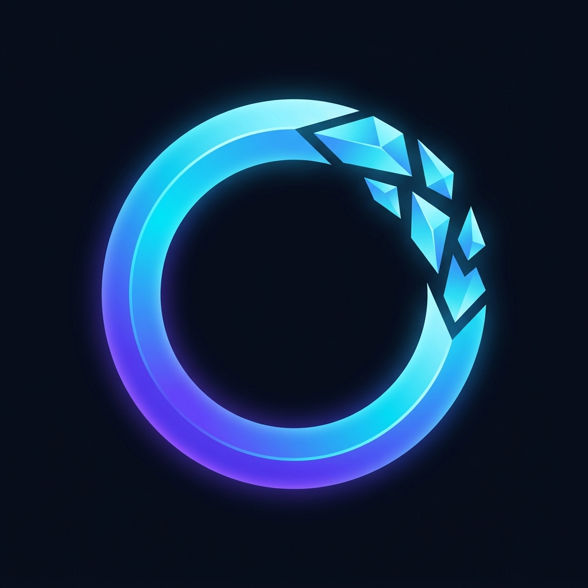
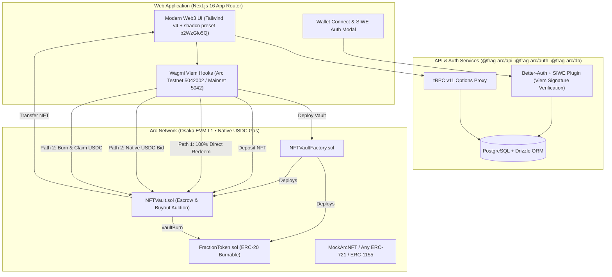

<div align="center">
  
  <h1>FragArc</h1>
  <p><strong>Bidirectional Decentralized NFT Fragmentation Platform on Circle's Arc Network</strong></p>
  <p>
    
    
    
    
  </p>
</div>

---

## Overview

**FragArc** is a production-ready, fully decentralized bidirectional NFT fragmentation platform engineered specifically for **Circle's Arc Network** (Osaka EVM Layer 1 with native 18-decimal USDC).

Collectibles (ERC-721 and ERC-1155) can be deposited into autonomous `NFTVault` smart contracts to mint liquid ERC-20 `FractionToken`s. NFTs can be reconstituted and redeemed through two decentralized, bidirectional pathways:

1. **Path 1: 100% Direct Token Redemption**: Any collector holding 100% of a vault's fractional supply can call `redeem()` to permanently burn all fraction tokens via `vaultBurn()` and withdraw the custodial NFT immediately.
2. **Path 2: Native USDC Buyout Auction & Pro-Rata Burn**: Any buyer can initiate a competitive buyout auction with native USDC (`msg.value`) $\ge$ `reservePrice`. Features a 3-day countdown with 15-minute anti-sniping extensions, pull-over-push refund withdrawals (`withdrawPendingFunds()`), and trustless pro-rata payout claiming via `burnAndClaim()`.

---

## System Architecture



---

## Arc Network Protocol Specifics Handled

| Protocol Nuance | Arc Specification | Implementation in FragArc |
| :--- | :--- | :--- |
| **Native Gas & Value** | Native token is USDC with 18 decimals (`10^18` wei) | Bids, payouts, and gas fees utilize `msg.value` directly without wrapped ERC-20 approvals. |
| **Gas Price Floor** | Protocol mempool rejects any tx with `maxFeePerGas < 20 Gwei` | Default gas floor constant `ARC_DEFAULT_GAS_FLOOR = 25 Gwei` configured across Hardhat, Wagmi, and frontend clients. |
| **Zero Address Guard** | Native transfers to `address(0)` revert | Burn mechanism modifies internal balances without triggering native value transfers to `0x0`. |
| **EVM Target** | Cancun / Osaka EVM compatibility | Hardhat compiler configured with `cancun` EVM target. |

---

## Tech Stack

- **Smart Contracts**: Solidity 0.8.28, Hardhat, OpenZeppelin v5, Viem test harness.
- **Frontend**: Next.js 16 (App Router, Turbopack), Tailwind CSS v4, shadcn/ui (preset `b2WzGlo5Q` with Rhea base, zinc base color, and violet theme).
- **Web3 Connectivity**: Wagmi v2, Viem v2, Sign-In with Ethereum (SIWE).
- **API & Data**: tRPC v11, Drizzle ORM, PostgreSQL.
- **Authentication**: Better-Auth with cryptographic SIWE verification plugin.
- **Monorepo**: Turborepo with Bun workspaces.

---

## Getting Started

### 1. Install Dependencies

```bash
bun install
```

### 2. Start PostgreSQL Database

```bash
bun run db:start
```

### 3. Run Database Migrations

```bash
bun run --cwd packages/db db:migrate
```

### 4. Run Smart Contract Tests

```bash
bun run --cwd packages/contracts test
```

### 5. Launch Development Server

```bash
bun run dev:web
```

Open [http://localhost:3001](http://localhost:3001) in your browser.

---

## Project Structure

```
frag-arc/
├── apps/
│   └── web/                # Next.js 16 App Router frontend
│       ├── public/         # FragArc logo, favicons, manifests
│       └── src/
│           ├── app/        # Marketplace, Fractionalize, Vault Detail, Portfolio, Faucet
│           ├── components/ # Branded FragArcLogo, WalletConnect, VaultCard
│           └── lib/        # Arc chain definitions (5042002 / 5042), Wagmi client
├── packages/
│   ├── contracts/          # NFTVaultFactory, NFTVault, FractionToken, MockArcNFT
│   ├── ui/                 # Shared shadcn/ui components (preset b2WzGlo5Q)
│   ├── api/                # tRPC routers (vaults, portfolio, faucet)
│   ├── auth/               # Better-Auth SIWE plugin with Viem verification
│   └── db/                 # Drizzle ORM schema, relations, and migrations
```

---

## License

MIT
